# Mini-projet 2 : AgriIrrigation sur Kubernetes (k3s)

Application trois niveaux (frontend, API REST, base PostgreSQL) que l'on fait
passer d'un projet « qui marche sur mon poste » à un service exploitable sur un
cluster k3s : configuration externalisée, secrets protégés, données
persistantes et sauvegardées, ressources maîtrisées, surface d'attaque réduite.

Cours : Orchestration de conteneurs avec Kubernetes (k3s), Master DevOps & Cloud,
ISET Tozeur. Le détail des preuves (captures, sorties de commandes, réponses aux
questions) se trouve dans [docs/rapport-notes.md](docs/rapport-notes.md).

## Sommaire
1. Application
2. Architecture
3. Structure du dépôt
4. Lancer l'application en local
5. Configuration de l'API
6. Images
7. Déploiement sur Kubernetes
8. Avancement par exigence
9. Sécurité du dépôt
10. Tests
11. Procédure de restauration

## 1. Application
AgriIrrigation permet de gérer des parcelles agricoles et de planifier leurs
arrosages. Chaque entité offre un CRUD complet :
- parcelles : créer, lister, supprimer
- arrosages : planifier, lister, enregistrer la consommation réelle (avec
  calcul de l'écart avec le volume prévu), supprimer

Points de contrôle de l'API :
- `GET /health` : le processus répond (toujours 200)
- `GET /ready` : 200 seulement si la base répond, sinon 503

Les logs sont écrits sur la sortie standard.

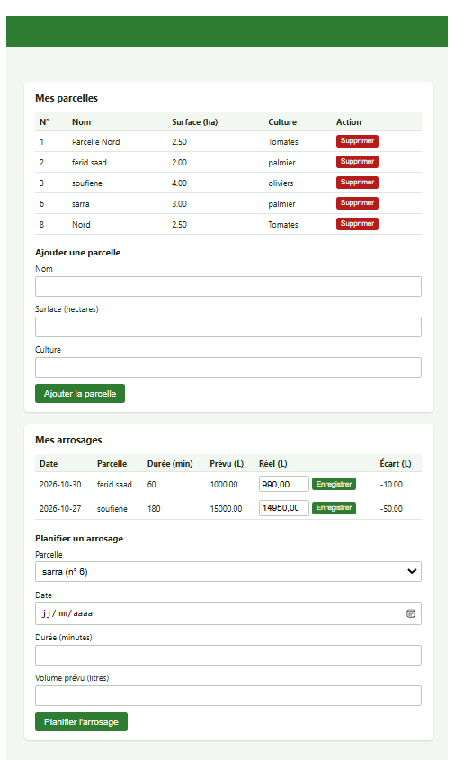
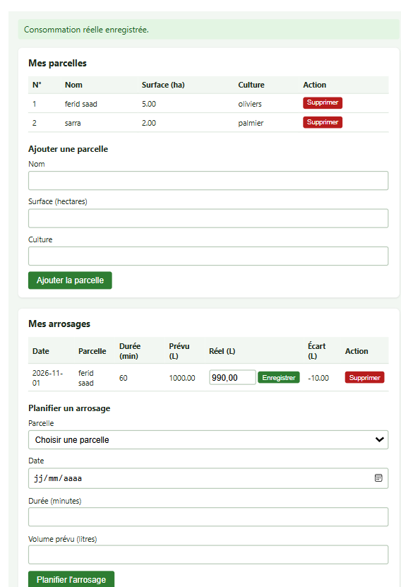
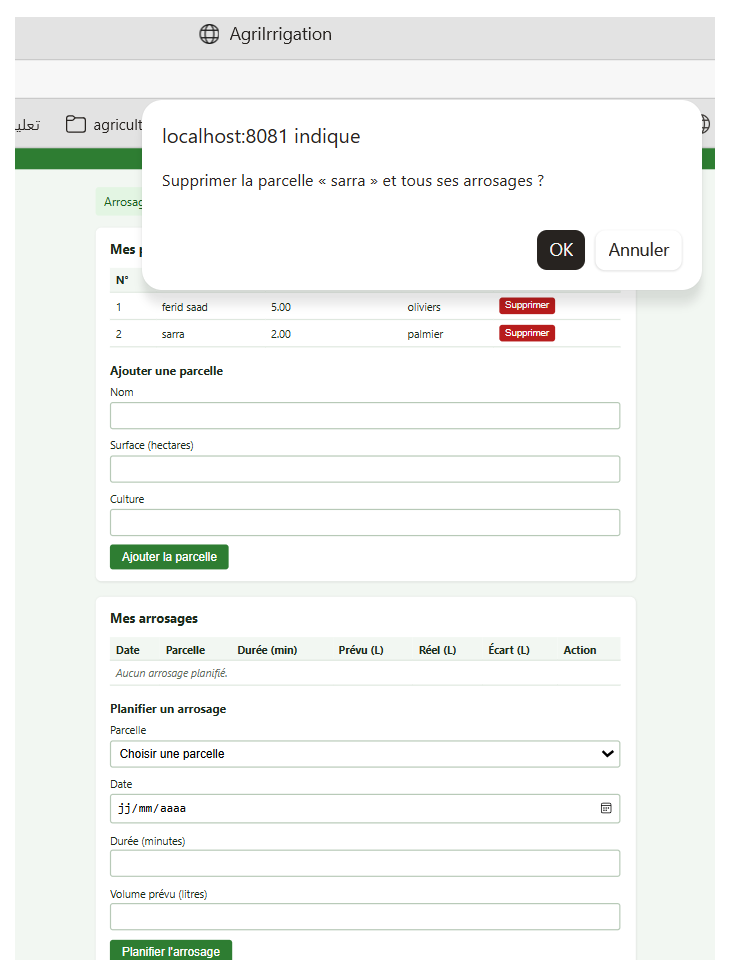

## 2. Architecture

    Navigateur -> frontend (nginx, 8080) --/api/--> API Node/Express (3000) -> PostgreSQL (5432)

| Composant | Technologie | Dossier |
|-----------|-------------|---------|
| Frontend | HTML/JS servi par nginx-unprivileged | app/frontend |
| API | Node.js 20, Express, pg | app/api |
| Base | PostgreSQL 16 (image officielle) | k8s/20-db |

Seul le frontend sera exposé par l'Ingress (phase 6) ; il relaie les appels
`/api/` vers l'API, de l'intérieur du cluster. La base n'est joignable que par
l'API et par le job de sauvegarde (NetworkPolicies, phase 10).

Choix : l'authentification JWT du projet d'origine a été retirée pour se
concentrer sur l'exploitation Kubernetes, et la route `DELETE /arrosages/:id`
a été ajoutée pour obtenir un CRUD complet.

## 3. Structure du dépôt

    app/api/              code, tests Jest et Dockerfile de l'API
    app/frontend/         interface web et Dockerfile
    dev/                  configuration nginx pour le test local (Compose)
    k8s/00-namespace/     namespace, ResourceQuota, LimitRange
    k8s/10-config/        ConfigMap ; modèle de Secret dans examples/
    k8s/20-db/            Service headless et StatefulSet PostgreSQL
    k8s/30-app/           API, frontend, Ingress (à venir)
    k8s/40-security/      RBAC, NetworkPolicies (à venir)
    docs/                 rapport et captures
    docker-compose.yml    lancement local des trois services
    .env.example          modèle des variables (le vrai .env n'est jamais versionné)

## 4. Lancer l'application en local (Docker Compose)

Prérequis : Docker Desktop démarré (attendre « Engine running »). Node.js 20 ou
plus n'est nécessaire que pour les tests.

1. Créer le fichier de configuration à partir du modèle, puis y mettre un mot de
   passe de test personnel :

       Copy-Item .env.example .env

2. Construire et démarrer db, api et frontend :

       docker compose up --build -d

3. Vérifier les services : `docker compose ps`
4. Ouvrir l'interface : http://localhost:8081
5. Vérifier l'API : `curl.exe http://localhost:8081/api/ready`

Arrêter et relancer :

       docker compose down        # arrête, les données restent dans le volume dbdata
       docker compose up -d       # relance sans reconstruire

Attention : `docker compose down -v` supprime le volume et donc toutes les
données. À n'utiliser que pour repartir d'une base neuve. C'est nécessaire si
le mot de passe de `.env` change après un premier démarrage, car PostgreSQL
conserve l'ancien mot de passe dans ses données (erreur `password
authentication failed`).

## 5. Configuration de l'API
Toute la configuration passe par des variables d'environnement, sans valeur par
défaut : l'API refuse de démarrer si l'une manque.

| Variable | Rôle | Source dans Kubernetes |
|----------|------|------------------------|
| DB_HOST, DB_PORT | adresse de la base | ConfigMap `app-config` |
| DB_NAME | nom de la base | ConfigMap `app-config` |
| API_PORT | port d'écoute de l'API | ConfigMap `app-config` |
| DB_USER, DB_PASSWORD | identifiants (jamais dans le code ni dans l'image) | Secret `db-credentials` |

## 6. Images

| Composant | Image | Base | Utilisateur |
|-----------|-------|------|-------------|
| API | feridsaad/agri-api:1.0.0 | node:20-alpine | node (non-root, uid 1000) |
| Frontend | feridsaad/agri-frontend:1.0.0 | nginxinc/nginx-unprivileged:1.27-alpine | nginx (non-root, port 8080) |
| Base | postgres:16-alpine | image officielle | utilisateur de l'image |

- Images publiques sur Docker Hub, versionnées (jamais `latest`).
- Aucun secret dans les images ; `.dockerignore` exclut `node_modules`, `tests`
  et `.git`.

Construction et publication :

    docker build -t feridsaad/agri-api:1.0.0 app/api
    docker build -t feridsaad/agri-frontend:1.0.0 app/frontend
    docker push feridsaad/agri-api:1.0.0
    docker push feridsaad/agri-frontend:1.0.0

Preuves : utilisateurs non-root, tag 1.0.0 sur Docker Hub, et Pods `Running` sur
worker1, worker2 et master.

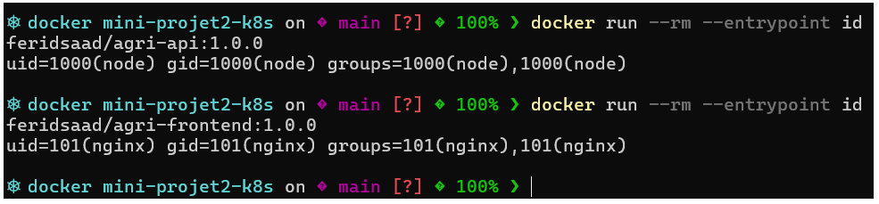
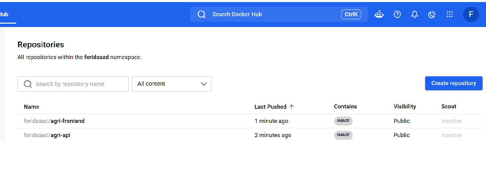
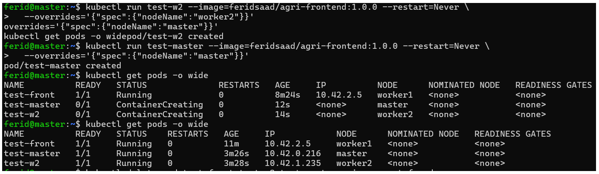

## 7. Déploiement sur Kubernetes (k3s)

Prérequis : cluster k3s à 3 nœuds (master, worker1, worker2). Toutes les commandes
`kubectl` se lancent depuis le **master** (l'API Kubernetes n'écoute que là).
Après un arrêt des VM, démarrer le master d'abord, attendre une à deux minutes,
puis vérifier avec `kubectl get nodes`.

Récupérer le dépôt sur le master :

    git clone https://github.com/ferid-saad/agri-k8s-miniprojet2.git
    cd agri-k8s-miniprojet2

Les manifestes sont rangés par dossier et appliqués dans l'ordre. Les fichiers
d'un dossier sont préfixés (00, 10, 20) car `kubectl apply -f <dossier>` les
applique par ordre alphabétique.

| Étape | Dossier | Contenu | Commande |
|-------|---------|---------|----------|
| 1 | k8s/00-namespace | namespace `agri`, ResourceQuota, LimitRange | `kubectl apply -f k8s/00-namespace/` |
| 2 | k8s/10-config | ConfigMap `app-config` et Secret `db-credentials` | voir ci-dessous |
| 3 | k8s/20-db | Service headless et StatefulSet PostgreSQL | `kubectl apply -f k8s/20-db/` |
| 4 | k8s/30-app | API, frontend, Ingress | à venir (phases 5 et 6) |
| 5 | k8s/40-security | RBAC, NetworkPolicies | à venir (phases 9 et 10) |

### Étape 1 : namespace, quotas et limites (phase 2)
Namespace dédié `agri`, avec :
- ResourceQuota `agri-quota` : 2 CPU et 2 Gi de requêtes, 4 CPU et 4 Gi de
  limites, 15 Pods, 4 PVC
- LimitRange `agri-limits` : un conteneur sans `resources` reçoit par défaut
  50m/64Mi de requêtes et 200m/256Mi de limites

Vérification :

    kubectl get ns agri
    kubectl describe quota -n agri
    kubectl describe limitrange -n agri

Un Pod qui dépasse le quota est refusé à la création (erreur `exceeded quota`) :
il n'existe pas, il n'attend pas en `Pending`.

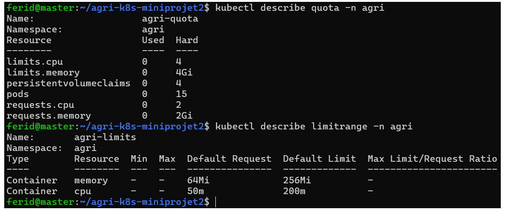
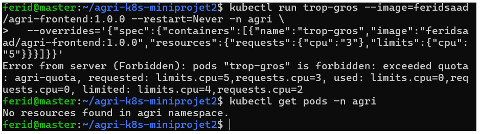

### Étape 2 : ConfigMap et Secret (phase 3)
Le ConfigMap se déploie directement :

    kubectl apply -f k8s/10-config/

Le Secret n'est **jamais** versionné. Il est créé à la main sur le master, avec
un mot de passe choisi pour le cluster (différent de celui du `.env` local) :

    kubectl create secret generic db-credentials -n agri \
      --from-literal=POSTGRES_USER=agri \
      --from-literal=POSTGRES_PASSWORD='<mot-de-passe>'

Un modèle aux fausses valeurs est versionné dans
`k8s/10-config/examples/secret.example.yaml`. Il est rangé dans `examples/`
pour ne jamais être appliqué par erreur (`apply -f` n'est pas récursif) : il
écraserait le vrai Secret par `changeme`.

Vérification :

    kubectl get configmap,secret -n agri
    kubectl describe configmap app-config -n agri

Un Secret n'est pas chiffré : il est seulement encodé en base64, donc lisible
par quiconque peut le lire via l'API. Pour qu'il reste confidentiel : RBAC
(phase 9), chiffrement au repos dans etcd, aucun versionnement.

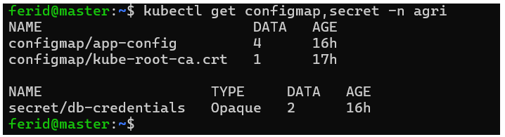

### Étape 3 : base de données (phase 4)
    kubectl apply -f k8s/20-db/
    kubectl get pods,pvc,svc -n agri

- Service headless `db` (`clusterIP: None`) : nom DNS stable utilisé dans
  `DB_HOST`
- StatefulSet `db` : 1 réplica, `postgres:16-alpine`, identifiants lus depuis le
  Secret et le ConfigMap, readiness probe `pg_isready`, requests 100m/256Mi et
  limits 500m/512Mi
- `PGDATA` placé dans un sous-dossier du point de montage, sinon PostgreSQL
  refuse de démarrer sur un volume qui contient `lost+found`
- Volume : PVC `data-db-0` (1Gi, ReadWriteOnce, StorageClass `local-path`) créé
  par `volumeClaimTemplates`
- Labels du Pod : `app: agri`, `tier: db` (utilisés par les NetworkPolicies)

Résultat attendu : `db-0` en `1/1 Running`, PVC `data-db-0` en `Bound`, service
`db` avec `CLUSTER-IP None`.

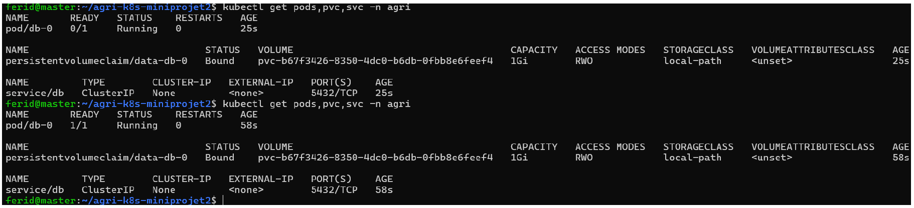

Test de connexion :

    kubectl exec -it db-0 -n agri -- sh -c 'psql -U "$POSTGRES_USER" -d "$POSTGRES_DB" -c "\conninfo"'

Pourquoi un StatefulSet plutôt qu'un Deployment : identité stable (`db-0`), nom
DNS stable via le Service headless, et un volume propre à chaque Pod, rattaché
de nouveau au même Pod après une suppression.

### Étape 4 : API et frontend (phase 5)

    kubectl apply -f k8s/30-app/
    kubectl get pods,svc -n agri

Les fichiers sont appliqués dans l'ordre : l'API et son Service d'abord, car
nginx résout `api-svc` au démarrage et refuse de démarrer si ce nom n'existe pas.

**API** (`k8s/30-app/10-api.yaml`)
- Deployment de 2 réplicas, image `feridsaad/agri-api:1.0.1`
- Configuration externalisée : `envFrom` sur le ConfigMap `app-config` (DB_HOST,
  DB_PORT, DB_NAME, API_PORT) et `secretKeyRef` sur le Secret `db-credentials`
  (exposé sous DB_USER et DB_PASSWORD)
- Init container `wait-for-db` (busybox, `nc -z db 5432`) : l'API ne démarre pas
  tant que la base ne répond pas (E7)
- Sondes : readiness sur `/ready`, liveness sur `/health` (E9)
- Ressources : API 50m/64Mi (requests) et 200m/256Mi (limits) ; init container
  10m/16Mi et 50m/32Mi (E8)
- Service `api-svc` (ClusterIP, 3000)

**Frontend** (`k8s/30-app/20-frontend-config.yaml` et `30-frontend.yaml`)
- Deployment de 1 réplica, image `feridsaad/agri-frontend:1.0.0`
- Configuration nginx dans le ConfigMap `frontend-nginx`, montée en fichier avec
  `subPath` sur `/etc/nginx/conf.d/default.conf` ; `/api/` est relayé vers
  `api-svc:3000`
- Readiness probe sur `/`, ressources 50m/32Mi et 100m/128Mi
- Service `frontend-svc` (ClusterIP, 80 vers 8080)

Remarque : un montage `subPath` n'est pas rafraîchi automatiquement. Après toute
modification du ConfigMap `frontend-nginx` :

    kubectl rollout restart deployment/frontend -n agri

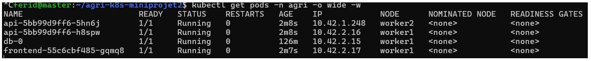
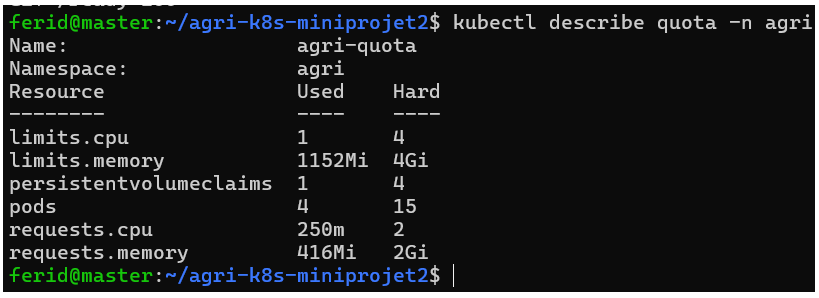

**Vérifications**

    kubectl logs deployment/api -n agri
    kubectl run curl-test --rm -it --image=curlimages/curl --restart=Never -n agri -- \
      curl -s http://frontend-svc/api/ready

Les logs doivent contenir « écoute sur le port 3000 », ce qui prouve la connexion
à la base. Le `curl` doit renvoyer `{"status":"ready"}` : il traverse le Service
du frontend, le proxy nginx, l'API et la base.

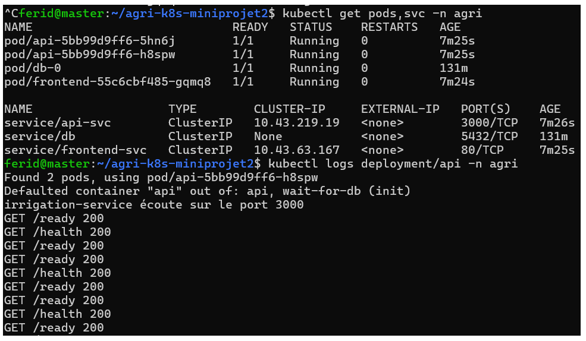

**Comportement de la readiness probe**

Tant que sa readiness probe échoue, un Pod reste en `Running` mais est marqué non
prêt (`0/1`) : Kubernetes le retire des endpoints du Service et il ne reçoit plus
de trafic. Il n'est pas redémarré, car c'est le rôle de la liveness probe. Dès
que la probe réussit de nouveau, il est réintégré automatiquement.

Démonstration avec la base arrêtée :

    kubectl scale statefulset db --replicas=0 -n agri
    kubectl get pods -n agri
    kubectl get endpoints api-svc -n agri
    kubectl scale statefulset db --replicas=1 -n agri

Pendant la panne, `/ready` renvoie 503, les Pods de l'API passent en `0/1` et la
liste des endpoints de `api-svc` est vide. La base relancée, tout revient sans
intervention. Les données sont intactes, car le volume n'a pas été touché.

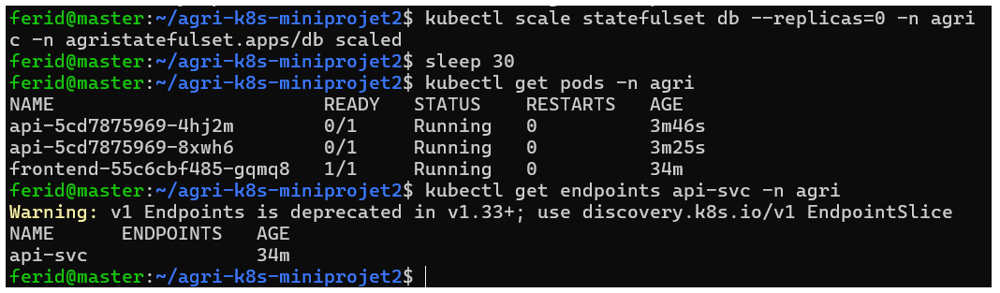
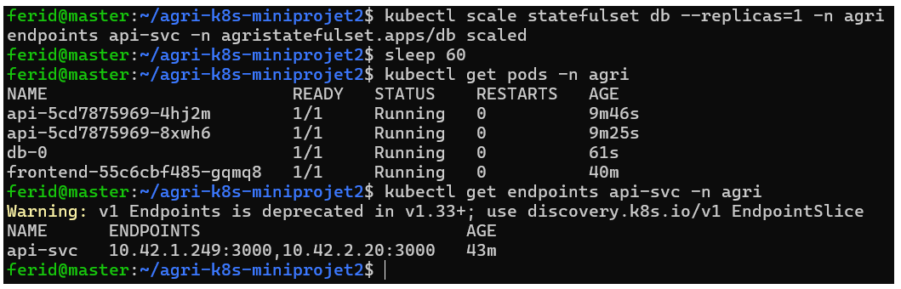

**Incident rencontré et correction (image 1.0.1)**

Avec la première version de l'API (`1.0.0`), arrêter la base faisait partir les
Pods en `CrashLoopBackOff`. Le pool `pg` émet un événement `error` quand la base
ferme ses connexions ; sans gestionnaire, Node arrête le processus. L'init
container ne se rejoue pas au redémarrage d'un conteneur, donc l'API échouait
en boucle tant que la base était absente. Un gestionnaire `pool.on('error')` a
été ajouté dans `db.js` et l'image republiée en `1.0.1` (un tag publié n'est
jamais réécrit). Une base arrêtée ne tue plus l'API : elle devient seulement
non prête.

En cas de problème :

| Symptôme | Piste |
|----------|-------|
| `Init:0/1` qui dure | la base n'est pas prête : `kubectl logs db-0 -n agri` |
| `CrashLoopBackOff` sur l'API | `kubectl logs <pod> -n agri` : variable manquante ou `password authentication failed` |
| `password authentication failed` | le Secret ne correspond pas au mot de passe avec lequel la base a été initialisée (le volume garde l'ancien) |
| Frontend en erreur `host not found in upstream` | `api-svc` n'existait pas au démarrage : `kubectl rollout restart deployment/frontend -n agri` |
| Pod refusé à la création | quota dépassé : `kubectl describe quota -n agri` |

### Etape 5 : Ingress (Phase 6)

### Réalisation
- Ingress `agri-ingress` (classe `traefik`, fournie par k3s) : hôte `app.k3s.local`,
  chemin `/` vers `frontend-svc:80`
- Manifeste : k8s/30-app/40-ingress.yaml
- Windows : entrée `<IP> app.k3s.local` dans C:\Windows\System32\drivers\etc\hosts

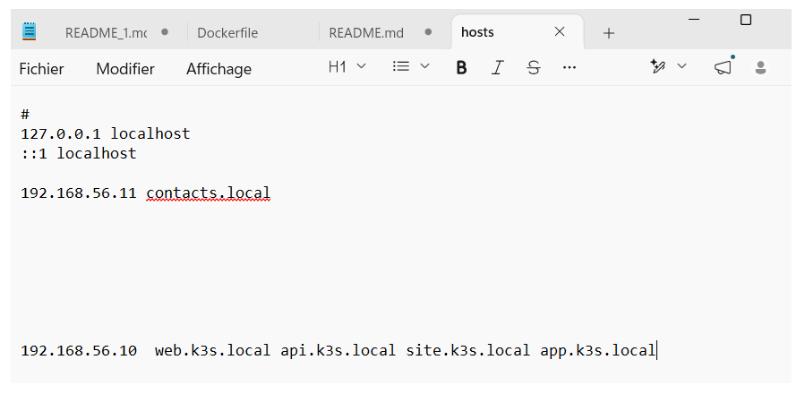

### Preuves (exigence E10)
- `kubectl get ingress -n agri` : un seul Ingress, vers le frontend
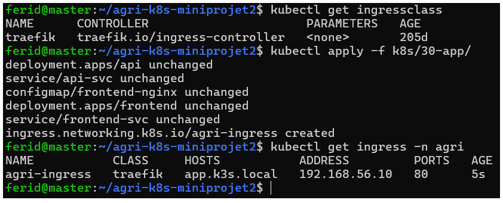
- `kubectl get svc -n agri` : uniquement des ClusterIP (aucun NodePort ni LoadBalancer)
- Interface ouverte sur http://app.k3s.local : 

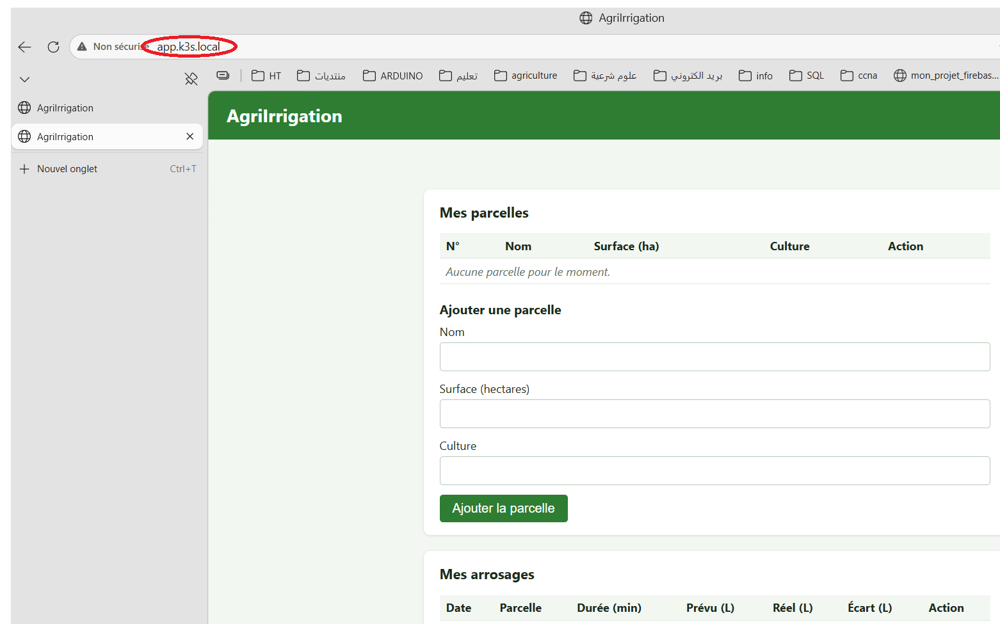

- Données saisies visibles en base :

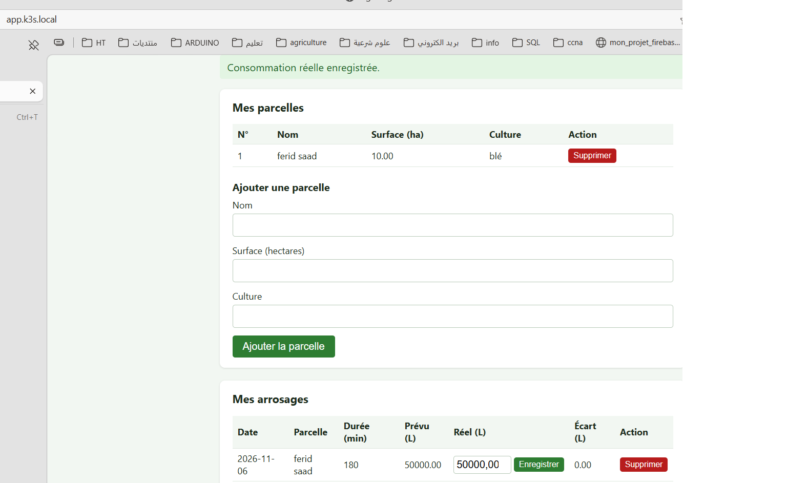

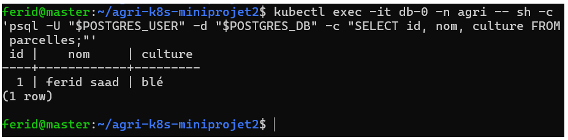
 

### Question : pourquoi ne pas exposer aussi l'API et la base par l'Ingress ?

La base n’a aucune raison d’être accessible depuis l’extérieur : son exposition ouvrirait directement les données à toute tentative de connexion.
L’API n’est utilisée que par le frontend. La garder interne réduit la surface d’attaque : un seul composant à protéger, et un seul point où appliquer des règles (TLS, limitation de débit, journalisation).
Le frontend joue le rôle de façade : il relaie /api/ en interne, donc le navigateur n’a jamais besoin d’adresser l’API directement, et il n’y a pas de problème de CORS.
Cela prépare les NetworkPolicies (phase 10) : la matrice de flux n’autorise que Traefik vers le frontend.

## Phase 7 : persistance et résilience

### Test de persistance (exigence E6)
1. Données saisies depuis l'interface : parcelle « Test-Persistance », un arrosage.
2. État avant :

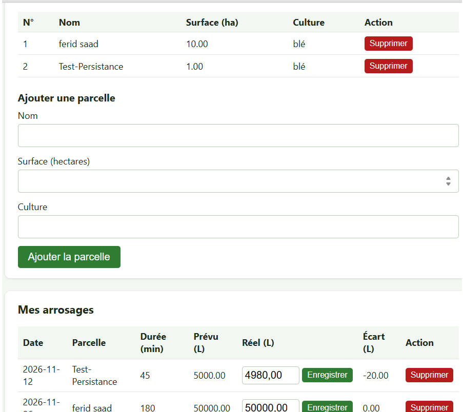

Requêtes SQL et `kubectl get pod db-0 -o wide`

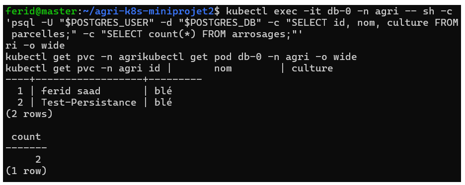

  3. `kubectl delete pod db-0 -n agri` : le StatefulSet recrée `db-0` (même nom, même
   PVC `data-db-0`), qui repasse en 1/1 Running.

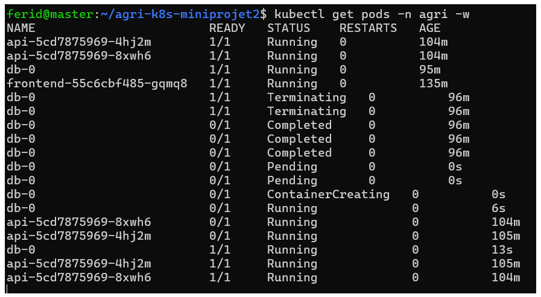

4. État après : les mêmes lignes sont retrouvées, zéro donnée perdue ;

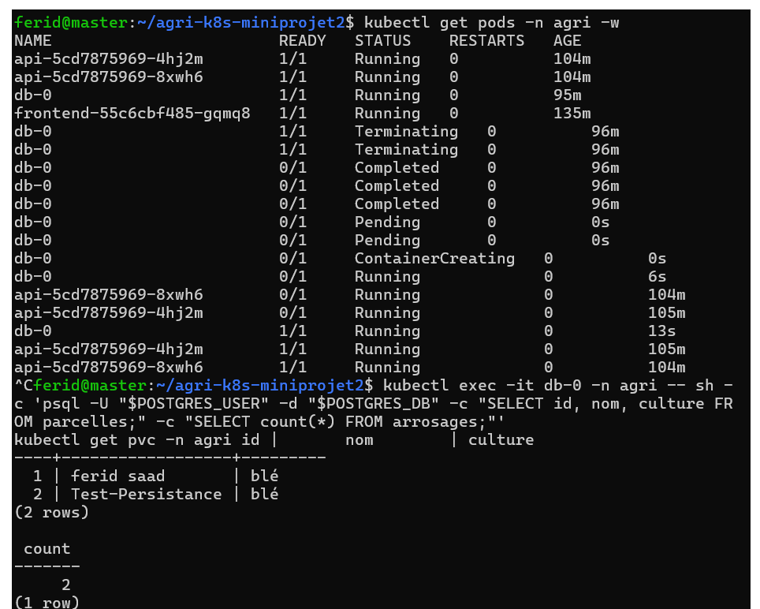

5. Pendant la coupure, les Pods de l'API passent en 0/1 sans redémarrer et
   reviennent seuls en 1/1.

### Résilience de l'API
Requêtes en continu à travers l'Ingress pendant la suppression d'un Pod de l'API :
les réponses restent 200, l'autre réplica prend le relais et le Deployment recrée
le Pod supprimé. (à compléter : nombre de réponses d'erreur éventuelles)
Capture : docs/captures/phase7-api.png

### Question : où sont physiquement les données avec local-path, et que se passe-t-il si le nœud tombe ?

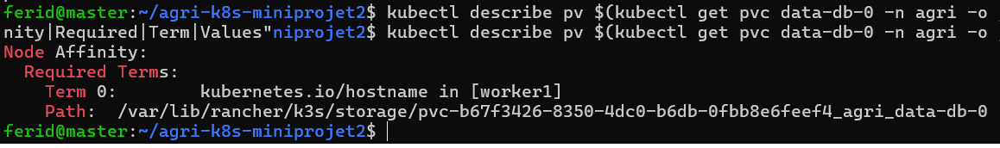

## Phase 8 : sauvegarde planifiée et restauration

### Réalisation
- PVC `backup-pvc` (1Gi, local-path) : volume dédié aux sauvegardes
- CronJob `db-backup` : `pg_dump --clean --if-exists` toutes les 5 minutes
  (démonstration), `concurrencyPolicy: Forbid`, historique de 3 Jobs réussis ;
  connexion par PGHOST, PGUSER, PGPASSWORD (Secret) et PGDATABASE (ConfigMap) ;
  requests 50m/64Mi, limits 200m/256Mi ; label `tier: backup`
- Job de restauration `db-restore` (k8s/20-db/restore/, non appliqué
  automatiquement) : recharge le dump le plus récent avec `psql`
- Manifestes : k8s/20-db/ (30-backup-pvc.yaml, 40-cronjob-backup.yaml)

### Preuves (exigence E11)
- Test immédiat : `kubectl create job --from=cronjob/db-backup test-backup` ;
  fichier `dump-AAAAMMJJ-HHMM.sql` créé : (à coller) ; capture : docs/captures/phase8-dump.png
- Exécutions automatiques : Jobs `db-backup-*` en Completed : docs/captures/phase8-cronjob.png
- Restauration : donnée supprimée, puis restaurée avec `db-restore` : données
  retrouvées. Captures : docs/captures/phase8-avant.png, phase8-suppression.png,
  phase8-restauration.png

### Question : une sauvegarde sur le même nœud que la base protège-t-elle d'une panne de ce nœud ? Que proposer ?
(texte de l'étape 7, adapté à votre constat sur les nœuds)

### Difficultés rencontrées
- backup-pvc reste en Pending jusqu'au premier Job (local-path attend un Pod
  consommateur pour créer le volume)
- (à compléter)

### Étapes suivantes (à compléter au fil des phases)

- Phase 9 : RBAC
- Phase 10 : durcissement des Pods et NetworkPolicies

## 8. Avancement par exigence

| N° | Exigence | État |
|----|----------|------|
| E1 | Images versionnées, accessibles à tous les nœuds | fait (phase 1) |
| E2 | Namespace, ResourceQuota, LimitRange | fait (phase 2) |
| E3 | ConfigMap et Secret | fait (phase 3) |
| E4 | Aucun secret réel dans Git | fait (voir section 9) |
| E5 | StatefulSet et Service headless | fait (phase 4) |
| E6 | Les données survivent à la suppression du Pod de la base | `kubectl delete pod db-0` : `db-0` recréé avec le même PVC `data-db-0`, données identiques avant et après|
| E7 | L'API attend la base | fait (phase 5, init container) |
| E8 | requests et limits | fait pour la base, l'API et le frontend |
| E9 | Sondes readiness et liveness | fait (phase 5) |
| E10 | Seul le frontend exposé par l'Ingress | à venir (phase 6) |
| E11 | CronJob de sauvegarde et restauration | à venir (phase 8) |
| E12 | RBAC | à venir (phase 9) |
| E13 | Durcissement des Pods | images non-root faites, reste à venir (phase 10) |
| E14 | NetworkPolicies | à venir (phase 10) |
| E15 | Dépôt Git et README | en cours |

## 9. Sécurité du dépôt
- `.env` et `secret.yaml` sont ignorés par Git
- `.env.example` et `secret.example.yaml` ne contiennent que de fausses valeurs
- Aucun secret réel dans le code, les manifestes ou les images
- Incident : un fichier `.env` contenant un mot de passe de test a été versionné
  par erreur au début du projet. Il a été retiré du suivi, le mot de passe a été
  changé et n'est plus utilisé, ni en local ni dans le cluster. Il reste visible
  dans l'historique Git : c'est pourquoi un mot de passe ne doit jamais être
  réutilisé après avoir été committé.

## 10. Tests

    cd app/api
    npm install
    npx jest

3 suites, 20 tests : la base est simulée, aucune dépendance externe.

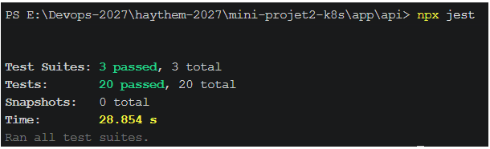

## 11. Procédure de restauration
(à compléter à la phase 8)