# Notes du rapport

## 1. Application et architecture
AgriIrrigation : suivi de l'irrigation de parcelles agricoles.
- Entités : parcelles et arrosages (création, lecture, modification de la
  consommation réelle, suppression)
- Trois niveaux : frontend (HTML/JS + nginx), API REST (Node.js/Express),
  base PostgreSQL
- Schéma : (à insérer : navigateur, Ingress, frontend, API, base, CronJob)

## 2. Phase 0 : développement et test en local
- Choix : l'authentification JWT du projet d'origine est retirée pour se
  concentrer sur l'exploitation Kubernetes ; la route DELETE /arrosages/:id
  est ajoutée pour un CRUD complet.
- Configuration entièrement par variables d'environnement, sans valeur par défaut.
- Preuves :
  - /health -> {"status":"ok"} ; /ready -> {"status":"ready"}
  - CRUD vérifié : POST, GET, PATCH, DELETE -> 204, puis 404 au second appel

  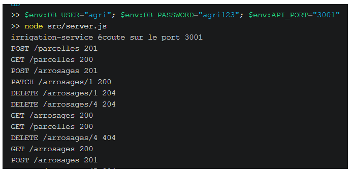
  
  - Tests Jest : 3 suites, 20 tests réussis
  
  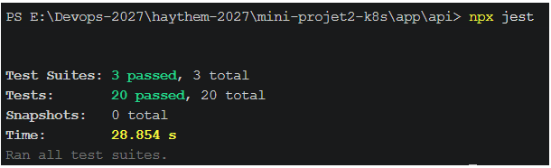
  
  - Lancement des trois services : `docker compose up --build -d`
    (captures : docs/img/phase0-compose-ps.png, docs/img/phase0-interface.png)
  
  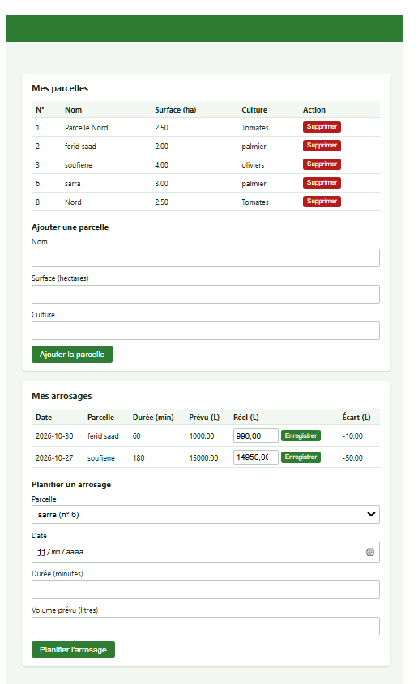


  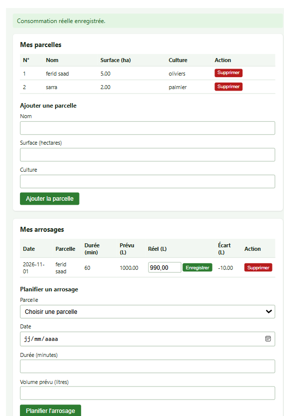


  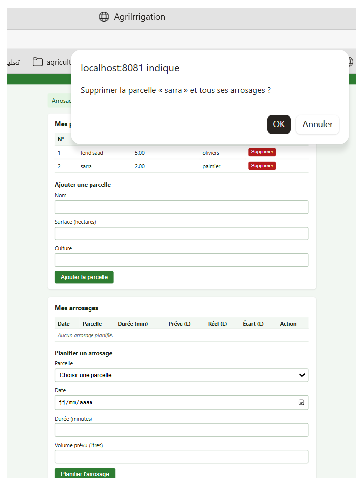

  - Point de contrôle : création, lecture, modification (consommation réelle) et
  suppression d'une parcelle et d'un arrosage vérifiées depuis l'interface, en
  local, avec Docker Compose (captures : docs/captures/crud-modification.png,
  docs/captures/crud-suppression.png)
- Lancement des trois services : `docker compose up --build -d` ; API en non-root
  (`id` -> uid=1000(node))
- Difficulté : port 8081 déjà occupé par un conteneur de test, qui causait une
  erreur 502 ; résolu en arrêtant ce conteneur et en recréant le frontend.

- Question : pourquoi un secret ne doit-il jamais figurer dans le code ni dans l'image ?
  Réponse : le code est versionné et partagé, et une image peut être récupérée
  par quiconque y a accès. Un secret qui y figure reste lisible dans
  l'historique Git ou dans les couches de l'image, même après suppression.
  On l'injecte donc à l'exécution (variables d'environnement, Secret Kubernetes).
- Difficultés : lancer les commandes depuis le bon dossier ; Docker Desktop non
  démarré ; dossier d'origine rattaché au dépôt du projet semestriel, d'où un
  nouveau dépôt Git dédié.

## 3. Phase 1 : conteneuriser et publier

### Images
| Composant | Image | Base | Utilisateur |
|-----------|-------|------|-------------|
| API | feridsaad/agri-api:1.0.0 | node:20-alpine | node (non-root) |
| Frontend | feridsaad/agri-frontend:1.0.0 | nginxinc/nginx-unprivileged:1.27-alpine | nginx (non-root), port 8080 |
| Base | postgres:16-alpine | image officielle | utilisateur de l'image |

- Les images sont versionnées (tag 1.0.0), jamais `latest` (exigence E1).
- Publication : Docker Hub, dépôts publics (option A du §6). Les nœuds k3s
  récupèrent les images par Internet, sans identifiants.
- Un fichier `.dockerignore` exclut `node_modules`, `tests` et `.git` du
  contexte de construction de l'API.
- Aucun secret dans les images : la configuration est injectée à l'exécution
  par variables d'environnement.

### Construction et vérification
```
docker build -t feridsaad/agri-api:1.0.0 app/api
docker build -t feridsaad/agri-frontend:1.0.0 app/frontend
docker run --rm --entrypoint id feridsaad/agri-api:1.0.0
docker run --rm --entrypoint id feridsaad/agri-frontend:1.0.0
docker push feridsaad/agri-api:1.0.0
docker push feridsaad/agri-frontend:1.0.0
```
- Sortie de `id` pour l'API : (à coller, attendu uid=1000(node))
- Sortie de `id` pour le frontend : (à coller, attendu uid=101(nginx))

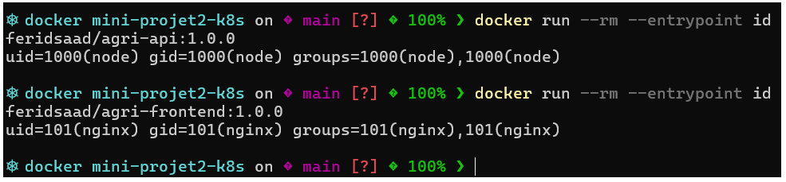

- Capture Docker Hub avec le tag 1.0.0 : 

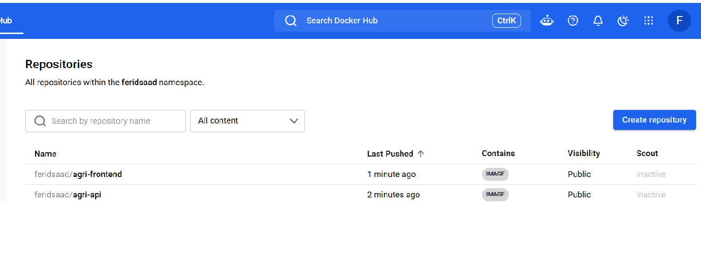

### Point de contrôle : l'image est accessible à tous les nœuds
Un Pod du frontend a été forcé sur chaque nœud avec `--overrides` (nodeName) :
```
kubectl run test-front  --image=feridsaad/agri-frontend:1.0.0 --restart=Never
kubectl run test-w2     --image=feridsaad/agri-frontend:1.0.0 --restart=Never \
  --overrides='{"spec":{"nodeName":"worker2"}}'
kubectl run test-master --image=feridsaad/agri-frontend:1.0.0 --restart=Never \
  --overrides='{"spec":{"nodeName":"master"}}'
kubectl get pods -o wide
```
Résultat : les trois Pods sont `Running` (1/1), sur worker1, worker2 et master.

| Pod | Nœud | Statut |
|-----|------|--------|
| test-front | worker1 | Running |
| test-w2 | worker2 | Running |
| test-master | master | Running |

Capture : 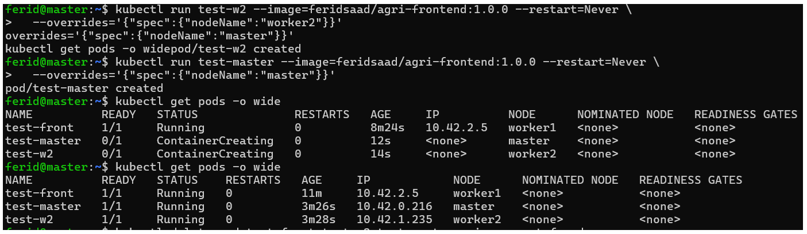

Image de l'API : un Pod de test a bien téléchargé l'image (événement
« Successfully pulled »). Il s'arrête ensuite en erreur de démarrage, ce qui est
attendu : l'API refuse de démarrer sans ses variables d'environnement `DB_*`
(à confirmer par la sortie de `kubectl describe pod test-api`). Les Pods de
test ont ensuite été supprimés.

### Question : imagePullPolicy Always ou IfNotPresent, et risque du tag latest ?
- `Always` interroge le registre à chaque démarrage de Pod : l'image est
  vérifiée à chaque fois, mais le démarrage est plus lent et dépend du réseau
  et de la disponibilité du registre.
- `IfNotPresent` réutilise l'image déjà présente sur le nœud, ce qui est plus
  rapide et fonctionne sans réseau, mais ne détecte pas une image modifiée sous
  le même tag.
- Le tag `latest` est mobile : il peut désigner des contenus différents selon
  le moment et selon le nœud qui a téléchargé l'image. Les déploiements
  deviennent non reproductibles, un retour en arrière est difficile, et deux
  Pods du même Deployment peuvent exécuter des versions différentes. Kubernetes
  applique d'ailleurs `Always` par défaut avec `latest`. Un tag de version fixe
  garantit que tous les nœuds exécutent exactement la même image.

### Difficultés rencontrées
- `kubectl` lancé depuis un worker : refus de connexion, car l'API Kubernetes ne
  tourne que sur le master.
- (compléter si besoin)

## 4. Phase 2 : Namespace, quotas et limites (séance 1)

- `kubectl describe quota -n agri` :
```
Resource                Used  Hard
limits.cpu              0     4
limits.memory           0     4Gi
persistentvolumeclaims  0     4
pods                    0     15
requests.cpu            0     2
requests.memory         0     2Gi
```
- `kubectl describe limitrange -n agri` : défauts memory 64Mi / 256Mi, cpu 50m / 200m

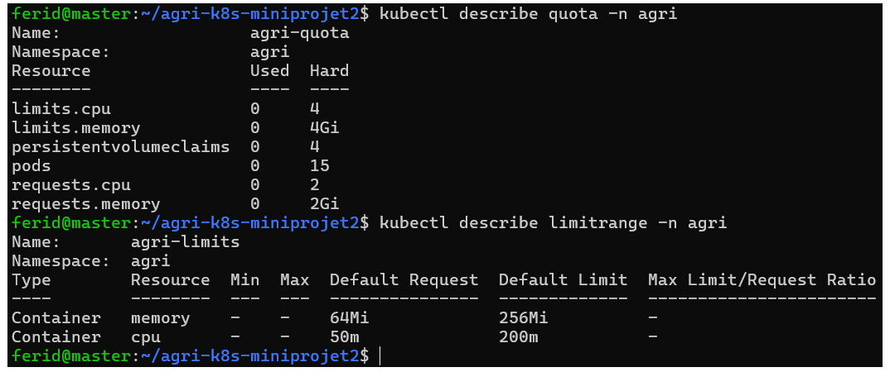

Pod sans resources (valeurs ajoutées par le LimitRange) :
```
{"limits":{"cpu":"200m","memory":"256Mi"},"requests":{"cpu":"50m","memory":"64Mi"}}
```
Le quota a alors enregistré : requests.cpu 50m, requests.memory 64Mi,
limits.cpu 200m, limits.memory 256Mi, pods 1.

Dépassement de quota :
```
Error from server (Forbidden): pods "trop-gros" is forbidden: exceeded quota:
agri-quota, requested: limits.cpu=5,requests.cpu=3, used: limits.cpu=0,
requests.cpu=0, limited: limits.cpu=4,requests.cpu=2
```
`kubectl get pods -n agri` : « No resources found » (le Pod n'a pas été créé).
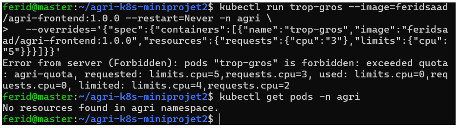

## 5. Phase 3 : Phase 3 : ConfigMap et Secret

- ConfigMap `app-config` : DB_HOST (db), DB_PORT, DB_NAME, API_PORT
- Secret `db-credentials` : POSTGRES_USER, POSTGRES_PASSWORD, créé avec
  `kubectl create secret generic ... --dry-run=client -o yaml` ; le fichier
  généré (secret.yaml) est ignoré par Git ; seul un modèle aux fausses valeurs
  (k8s/10-config/examples/secret.example.yaml) est versionné (exigences E3 et E4)
- Preuve : `git status` ne montre aucun secret ; `kubectl get secret` ; décodage base64

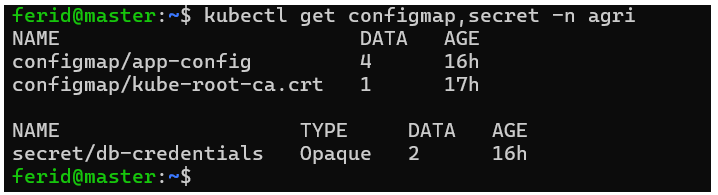

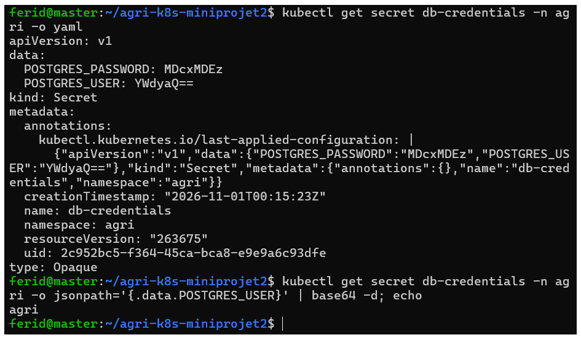

- Question : un Secret est-il chiffré ?
  Réponse : non, il est seulement encodé en base64, donc lisible par quiconque
  peut le lire via l'API. Pour qu'il reste confidentiel : limiter les droits
  (RBAC), activer le chiffrement des Secrets au repos dans etcd, ne jamais
  les versionner et restreindre l'accès au cluster.
- Difficultés : le modèle `secret.example.yaml` est rangé hors du dossier
  appliqué pour ne pas écraser le vrai Secret.

## 6. Phase 4 : base de données en StatefulSet

### Réalisation
- Service headless `db` (clusterIP: None) : donne à la base un nom DNS stable
  (`db`) utilisé par l'API dans `DB_HOST`
- StatefulSet `db` : 1 réplica, image postgres:16-alpine
  - identifiants lus depuis le Secret `db-credentials` (secretKeyRef) et nom de
    la base depuis le ConfigMap `app-config` (configMapKeyRef) : aucun mot de
    passe dans le manifeste
  - `PGDATA=/var/lib/postgresql/data/pgdata` : sous-dossier du point de
    montage, car PostgreSQL refuse de démarrer dans un dossier racine de volume
    qui contient déjà `lost+found`
  - readiness probe : `pg_isready`
  - requests 100m / 256Mi, limits 500m / 512Mi (exigence E8)
  - volumeClaimTemplates : PVC `data-db-0`, 1Gi, ReadWriteOnce, StorageClass
    `local-path`
- Labels du Pod : `app: agri`, `tier: db` (réutilisés par les NetworkPolicies
  de la phase 10)
- Manifestes : k8s/20-db/ (10-service.yaml, 20-statefulset.yaml)

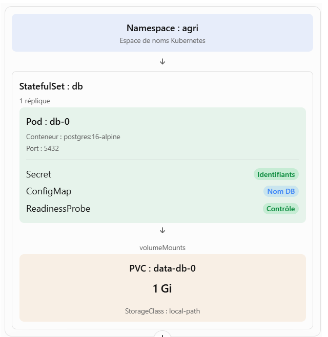
## Phase 6 : Ingress

### Réalisation
- Ingress `agri-ingress` (classe `traefik`, fournie par k3s) : hôte `app.k3s.local`,
  chemin `/` vers `frontend-svc:80`
- Manifeste : k8s/30-app/40-ingress.yaml
- Windows : entrée `<IP> app.k3s.local` dans C:\Windows\System32\drivers\etc\hosts

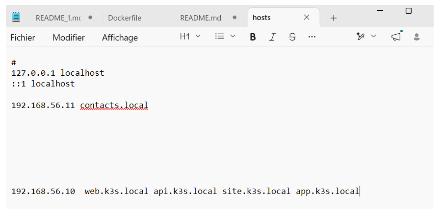

### Preuves (exigence E10)
- `kubectl get ingress -n agri` : un seul Ingress, vers le frontend
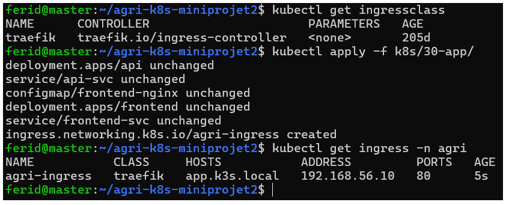
- `kubectl get svc -n agri` : uniquement des ClusterIP (aucun NodePort ni LoadBalancer)
- Interface ouverte sur http://app.k3s.local : 

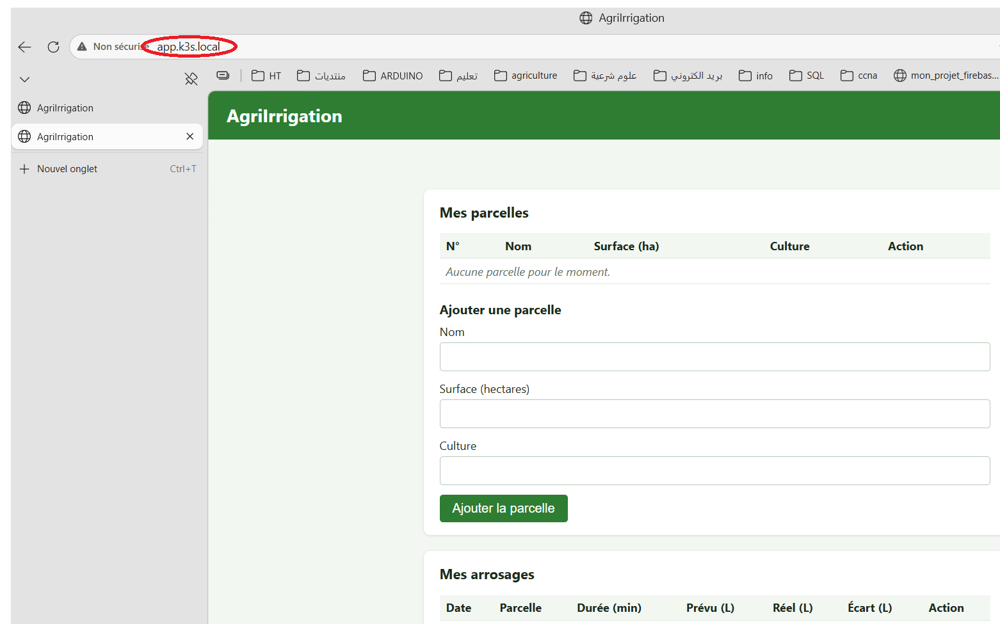

- Données saisies visibles en base :

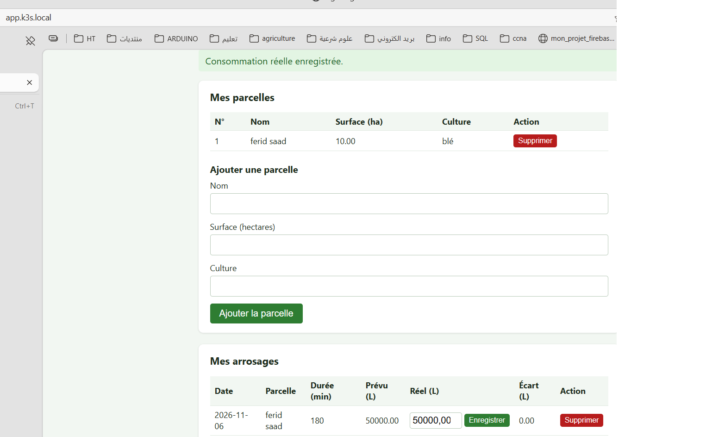

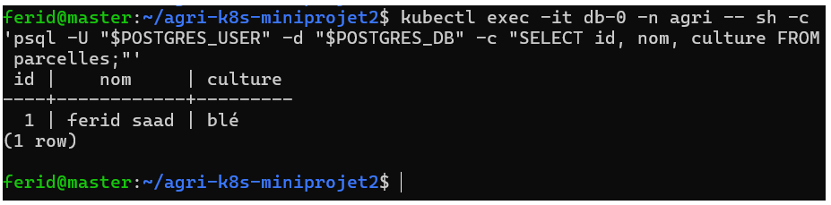
 

### Question : pourquoi ne pas exposer aussi l'API et la base par l'Ingress ?

La base n’a aucune raison d’être accessible depuis l’extérieur : son exposition ouvrirait directement les données à toute tentative de connexion.
L’API n’est utilisée que par le frontend. La garder interne réduit la surface d’attaque : un seul composant à protéger, et un seul point où appliquer des règles (TLS, limitation de débit, journalisation).
Le frontend joue le rôle de façade : il relaie /api/ en interne, donc le navigateur n’a jamais besoin d’adresser l’API directement, et il n’y a pas de problème de CORS.
Cela prépare les NetworkPolicies (phase 10) : la matrice de flux n’autorise que Traefik vers le frontend.

### Difficultés rencontrées
- (à compléter)

### Preuves (exigence E5)
`kubectl get pods,pvc,svc -n agri` :
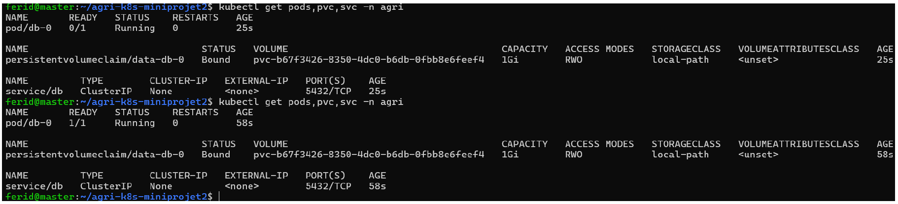

| Ressource | État |
|-----------|------|
| pod/db-0 | 0/1 Running à 25 s, puis 1/1 Running à 58 s (readiness probe validée) |
| persistentvolumeclaim/data-db-0 | Bound, 1Gi, RWO, local-path |
| service/db | ClusterIP None (headless), port 5432/TCP |

Capture : docs/captures/phase4-pods-pvc-svc.png

Connexion à la base :

    kubectl exec -it db-0 -n agri -- sh -c 'psql -U "$POSTGRES_USER" -d "$POSTGRES_DB" -c "\conninfo"'

Sortie :


### Question : pourquoi un StatefulSet plutôt qu'un Deployment pour une base ?
Un StatefulSet donne à chaque Pod une identité stable : un nom prévisible
(`db-0`) et un nom DNS stable grâce au Service headless. Chaque Pod reçoit son
propre volume, créé par `volumeClaimTemplates`, et ce même volume est
rattaché de nouveau au même Pod lorsqu'il est recréé. Un Deployment crée des
Pods interchangeables, aux noms aléatoires, sans lien garanti avec un volume
précis : après une suppression, un nouveau Pod n'est pas assuré de retrouver
les données. Les StatefulSets démarrent et s'arrêtent aussi dans un ordre
défini, ce qui convient aux services qui gardent un état.

### Difficultés rencontrées
- (Le délai de démarrage de la première minute, le
  temps de télécharger l'image et de créer le volume)

## Phase 5 : API et frontend

### Réalisation
- API : Deployment de 2 réplicas, image feridsaad/agri-api:1.0.0
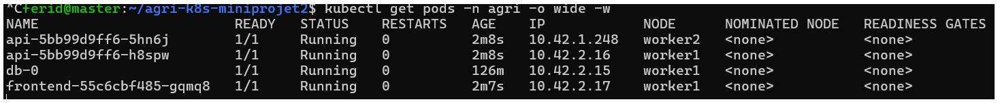
  - configuration par `envFrom` (ConfigMap `app-config`) et `secretKeyRef`
    (Secret `db-credentials`, exposé sous DB_USER et DB_PASSWORD)
  - init container `wait-for-db` (busybox, `nc -z db 5432`) : l'API ne démarre
    pas tant que la base ne répond pas (exigence E7)
  - readinessProbe `/ready`, livenessProbe `/health` (exigence E9)
  - requests 50m/64Mi, limits 200m/256Mi ; init container 10m/16Mi, 50m/32Mi (E8)
  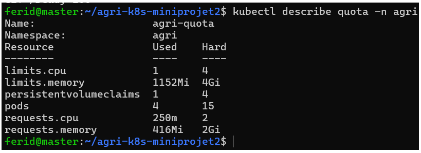
  - Service `api-svc` (ClusterIP, 3000)
- Frontend : Deployment de 1 réplica, image feridsaad/agri-frontend:1.0.0
  - configuration nginx dans le ConfigMap `frontend-nginx`, montée en fichier
    avec `subPath` sur /etc/nginx/conf.d/default.conf ; `/api/` relayé vers
    `api-svc:3000`
  - readinessProbe sur `/`, requests 50m/32Mi, limits 100m/128Mi
  - Service `frontend-svc` (ClusterIP, 80 vers 8080)
- Manifestes : k8s/30-app/ (10-api.yaml, 20-frontend-config.yaml, 30-frontend.yaml)

### Preuves
- `kubectl get pods,svc -n agri` 
- `kubectl logs deployment/api -n agri` 

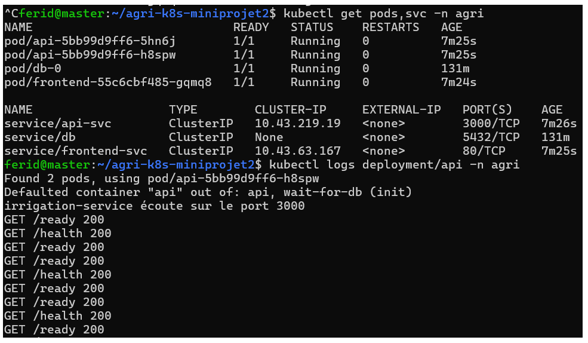
- Chaîne complète : `curl http://frontend-svc/api/ready` -> {"status":"ready"}

### Question : que fait Kubernetes de l'API tant que la readiness probe échoue ?
Le Pod reste en `Running` mais est marqué non prêt (`0/1`) : Kubernetes le retire
des endpoints du Service, il ne reçoit plus de trafic. Il n'est pas redémarré
(c'est le rôle de la liveness probe). Dès que la probe réussit de nouveau, il
est réintégré automatiquement.

 Démonstration : base arrêtée avec
`kubectl scale statefulset db --replicas=0`, `/ready` renvoie 503, les Pods
passent en 0/1 et la liste des endpoints de `api-svc` est vide ; 

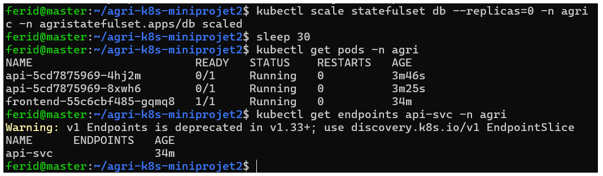

la base relancée, tout revient sans intervention (capture : docs/captures/phase5-readiness.png).

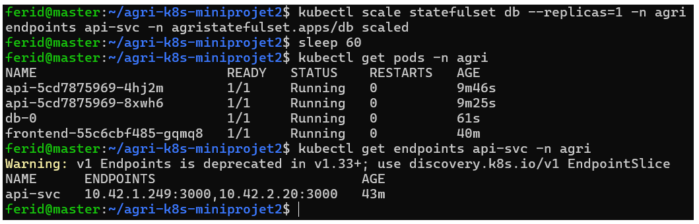

### Difficultés rencontrées
- (à compléter)
## Tableau des exigences (preuves)

| N° | Exigence | Preuve |
|----|----------|--------|
| E1 | Images versionnées, accessibles à tous les nœuds | Images `feridsaad/agri-api:1.0.0` et `feridsaad/agri-frontend:1.0.0` (jamais `latest`), publiques sur Docker Hub. Pods `Running` sur worker1, worker2 et master. Captures : [duckerhub.png](./captures/duckerhub.png), [pod-test-sur-les-autres-noeuds.png](./captures/pod-test-sur-les-autres-noeuds.png) |
| E2 | Namespace dédié, ResourceQuota et LimitRange | Namespace `agri`, `agri-quota` (2 CPU / 2 Gi de requêtes, 4 CPU / 4 Gi de limites, 15 Pods, 4 PVC), `agri-limits` (défauts 50m/64Mi et 200m/256Mi). Un Pod sans `resources` reçoit ces valeurs ; un Pod trop gros est refusé (`exceeded quota`). Manifestes : `k8s/00-namespace/`. Captures : [quota-limitrange.png](./captures/quota-limitrange.png), [depassement-de-quota.png](./captures/depassement-de-quota.png) |
| E3 | Paramètres non sensibles dans un ConfigMap, identifiants dans un Secret | ConfigMap `app-config` (DB_HOST, DB_PORT, DB_NAME, API_PORT) et Secret `db-credentials` (POSTGRES_USER, POSTGRES_PASSWORD), lus par le StatefulSet via `configMapKeyRef` et `secretKeyRef`. Manifestes : `k8s/10-config/`. Captures : [configmap-secret.png](./captures/configmap-secret.png) |
| E4 | Aucun secret réel versionné dans Git | `.env` et `secret.yaml` dans `.gitignore` ; seuls `.env.example` et `k8s/10-config/examples/secret.example.yaml` (fausses valeurs) sont versionnés ; le Secret du cluster est créé à la main sur le master avec un mot de passe distinct de celui du `.env`. Réserve : un `.env` a été committé par erreur au début, retiré du suivi et son mot de passe n'est plus utilisé (voir difficultés de la phase 0) |
| E5 | Base déployée par un StatefulSet avec volume persistant et Service headless | StatefulSet `db` avec `volumeClaimTemplates` (PVC `data-db-0`, 1Gi, `local-path`, `Bound`) et Service `db` en `clusterIP: None`. `db-0` passe en `1/1 Running`. Manifestes : `k8s/20-db/`. Captures : [pods-pvc-svc.png](./captures/pods-pvc-svc.png), [recap-statefulset.png](./captures/recap-statefulset.png) |
| E6 | Les données survivent à la suppression du Pod de la base | à compléter (phase 7) |
| E7 | L'API attend que la base soit prête | à compléter (phase 5) |
| E8 | Chaque conteneur définit requests et limits | Base : requests 100m/256Mi, limits 500m/512Mi (`k8s/20-db/20-statefulset.yaml`). API et frontend : à compléter (phase 5) |
| E9 | Readiness probe `/ready` et liveness probe `/health` sur l'API | Routes `/ready` et `/health` implémentées et testées (phase 0, [api-repond.png](./captures/api-repond.png)) ; sondes Kubernetes à compléter (phase 5). Base : readiness probe `pg_isready` en place |
| E10 | Seul le frontend est exposé par un Ingress sur `app.k3s.local` | à compléter (phase 6) |
| E11 | CronJob de sauvegarde et restauration testée | à compléter (phase 8) |
| E12 | ServiceAccount dédié sans jeton monté, compte de consultation | à compléter (phase 9) |
| E13 | Pods non-root, `allowPrivilegeEscalation: false`, capabilities supprimées | Images non-root (API uid 1000, frontend nginx-unprivileged), preuve : [non-root.png](./captures/non-root.png). Reste à appliquer dans les manifestes (phase 10) |
| E14 | NetworkPolicies conformes à la matrice de flux | à compléter (phase 10) |
| E15 | Manifestes rangés par dossier, dépôt Git, README de déploiement | Dépôt public https://github.com/ferid-saad/agri-k8s-miniprojet2, dossiers `k8s/00-namespace` à `k8s/40-security`, README avec ordre de déploiement. En cours : se complète jusqu'à la phase 10 |